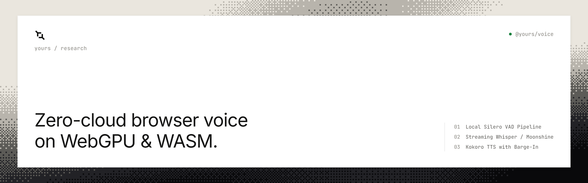
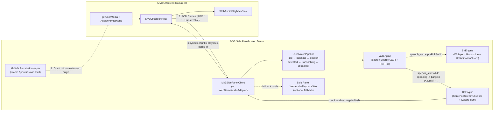

<p align="center">
  <a href="https://yours.sh">
    <picture>
      <source media="(prefers-color-scheme: dark)" srcset="https://raw.githubusercontent.com/yours-research/yours-voice/main/assets/hero-dark.png" />
      <source media="(prefers-color-scheme: light)" srcset="https://raw.githubusercontent.com/yours-research/yours-voice/main/assets/hero-light.png" />
      
    </picture>
  </a>
</p>

<p align="center">
  <a href="https://yours.sh">yours.sh</a> ·
  <a href="https://github.com/yours-research">GitHub Org</a> ·
  <a href="https://huggingface.co/yours-research">Hugging Face</a> ·
  <a href="https://x.com/yoursdotsh">X (@yoursdotsh)</a>
</p>

# `@yours/voice`

**100% local, zero-cloud browser voice SDK** engineered for **WebGPU & WASM** across **Chromium MV3 extensions (Side Panel + Offscreen Documents)** and **`yours.sh` Web Demos**.

`@yours/voice` unifies real-time 48 kHz / 44.1 kHz → **16 kHz mono** polyphase resampling, pre-roll hysteresis **Silero VAD** (with deterministic energy/ZCR fallback), throttled streaming **Whisper / Moonshine STT** with hallucination-loop protection, and **Kokoro-82M** sentence-chunked streaming TTS with **instant `<30ms` full-duplex barge-in cancellation** under a single `VoicePipeline` contract.

---

## Features

- **Zero External Network Requests:** All capture, resampling, VAD, STT, TTS, and playback run locally inside the browser or extension origin.
- **High-Quality Real-Time Audio DSP (`src/audio/`):**
  - `PcmResampler`: Blackman-windowed sinc polyphase anti-aliased downsampler (48 kHz / 44.1 kHz → 16 kHz mono) with stateful fractional phase continuity across `AudioWorklet` 128-sample render blocks.
  - `PcmFrameChunker` & `AudioRingBuffer`: Fixed 512-sample (32 ms) framing, RMS energy gate, and pre-roll ring buffer so initial consonants are never clipped.
- **Hysteresis VAD (`src/vad/`):**
  - `VadEngine` state machine (`silence → pending-speech → speech → hangover`) with `preRollMs`, `minSpeechMs`, `hangoverMs`, and `silenceEndMs`.
  - `SileroVadRunner` (ONNX/WASM v4 & v5 session adapter with automatic `[2, 1, 128]` state & 64-sample context management) + `EnergyZeroCrossingVadRunner` zero-model fallback.
- **Pluggable Local STT (`src/stt/`):**
  - `WhisperSttRunner` & `MoonshineSttRunner` adapters with `partialThrottleMs` UI update throttling, language hints, `AbortSignal` propagation, and `HallucinationGuard` (silence-phantom suppression + n-gram repetition-loop breaker).
- **Sentence-Chunked Streaming TTS & Instant Barge-In (`src/tts/`):**
  - `SentenceStreamChunker` splits streaming LLM token deltas on natural sentence/clause boundaries without breaking abbreviations (`Dr.`, `e.g.`, `U.S.`), version numbers (`v1.2.3`), decimals (`3.14`), or domains (`yours.sh`).
  - `TtsEngine` + `KokoroTtsRunner` synthesize lookahead chunks in FIFO queue order and drain/stop audio within `<30ms` on `bargeIn()`.
- **Chrome MV3 Mic Onboarding & Offscreen Bridge (`src/adapters/`):**
  - Solves Chromium MV3's Side Panel / Offscreen `getUserMedia` permission constraint via `Mv3MicPermissionHelper` (extension-origin `iframe` or `permissions.html` onboarding tab flow) + `Mv3OffscreenHost` / `Mv3SidePanelClient` RPC bridge with Side Panel Web Audio fallback playback.

---

## Architecture & Chrome MV3 Mic Flow



---

## Quickstart

### Installation

```bash
npm install @yours/voice
```

### 1. Web Demo (`yours.sh`) Quickstart

```ts
import {
  LocalVoicePipeline,
  WebDemoAudioAdapter,
  VadEngine,
  SileroVadRunner,
  SttEngine,
  WhisperSttRunner,
  TtsEngine,
  KokoroTtsRunner,
} from '@yours/voice';

const webAudio = new WebDemoAudioAdapter();

const pipeline = new LocalVoicePipeline({
  inputSource: webAudio.inputSource,
  vad: new VadEngine({
    // Plug in a Silero ONNX/WASM session, or omit for EnergyZeroCrossingVadRunner fallback
    runner: new SileroVadRunner({ session: sileroOrtSession, version: 'v5' }),
    preRollMs: 256,
    minSpeechMs: 96,
    hangoverMs: 320,
    silenceEndMs: 480,
  }),
  stt: new SttEngine({
    language: 'en',
    partialThrottleMs: 120,
    runner: new WhisperSttRunner({
      infer: async (audio, opts, signal) => localWhisperWorker.transcribe(audio, opts, signal),
    }),
  }),
  tts: new TtsEngine({
    sink: webAudio.playbackSink,
    lookaheadChunks: 2,
    runner: new KokoroTtsRunner({
      defaultVoiceId: 'af_heart',
      infer: async (text, opts, signal) => localKokoroWorker.synthesize(text, opts, signal),
    }),
  }),
});

pipeline.on('transcript', async (segment) => {
  if (!segment.isFinal) return;
  console.log('User:', segment.text);

  // Stream LLM tokens straight to Kokoro TTS with instant duplex barge-in
  await pipeline.speak(localLlm.streamReply(segment.text));
});

await pipeline.startListening({ language: 'en', bargeInEnabled: true });
```

### 2. Chrome MV3 Side Panel + Offscreen Document

**In `permissions.html` (extension onboarding page):**

```ts
import { completeMv3MicOnboarding } from '@yours/voice/adapters';

void completeMv3MicOnboarding();
```

**In `offscreen.ts` (MV3 Offscreen Document):**

```ts
import {
  ChromeRuntimePortTransport,
  Mv3OffscreenHost,
  WebDemoAudioAdapter,
} from '@yours/voice/adapters';

const audio = new WebDemoAudioAdapter();

chrome.runtime.onConnect.addListener((port) => {
  if (port.name !== 'yours-voice') return;
  new Mv3OffscreenHost({
    transport: new ChromeRuntimePortTransport(port),
    inputSource: audio.inputSource,
    playbackSink: audio.playbackSink,
  });
});
```

**In `sidepanel.ts` (MV3 Side Panel):**

```ts
import {
  ChromeRuntimePortTransport,
  LocalVoicePipeline,
  Mv3MicPermissionHelper,
  Mv3SidePanelClient,
  WebAudioPlaybackSink,
  ensureOffscreenDocument,
} from '@yours/voice';

await ensureOffscreenDocument({ url: 'offscreen.html' });
const port = chrome.runtime.connect({ name: 'yours-voice' });

const mv3Client = new Mv3SidePanelClient({
  transport: new ChromeRuntimePortTransport(port),
  permissionHelper: new Mv3MicPermissionHelper({
    permissionsPageUrl: 'permissions.html',
    strategy: 'iframe-then-tab',
  }),
  fallbackPlaybackSink: new WebAudioPlaybackSink(),
});

const pipeline = new LocalVoicePipeline({
  inputSource: mv3Client.createInputSource(),
  // ...vad, stt, and tts using mv3Client.createPlaybackSink()
});
```

---

## API Reference

| Module | Primary Exports | Purpose |
| :--- | :--- | :--- |
| `@yours/voice/contracts` | `VoicePipeline`, `VoiceState`, `TranscriptSegment`, `AudioInputSource`, `AudioPlaybackSink` | Shared ecosystem types (`docs/ECOSYSTEM_CONTRACTS.md`) |
| `@yours/voice/audio` | `PcmResampler`, `resamplePcm`, `downmixToMono`, `PcmFrameChunker`, `AudioRingBuffer`, `RmsEnergyGate`, `AUDIO_WORKLET_PROCESSOR_CODE` | Real-time 48/44.1 kHz → 16 kHz mono DSP & framing |
| `@yours/voice/vad` | `VadEngine`, `SileroVadRunner`, `EnergyZeroCrossingVadRunner` | Pre-roll hysteresis VAD + Silero v4/v5 & energy fallback |
| `@yours/voice/stt` | `SttEngine`, `WhisperSttRunner`, `MoonshineSttRunner`, `HallucinationGuard` | Throttled streaming STT + phantom/loop filtering |
| `@yours/voice/tts` | `TtsEngine`, `KokoroTtsRunner`, `SentenceStreamChunker`, `chunkTextStream`, `NullAudioPlaybackSink` | Lookahead sentence-chunked TTS + `<30ms` `bargeIn()` |
| `@yours/voice/adapters` | `Mv3MicPermissionHelper`, `completeMv3MicOnboarding`, `ensureOffscreenDocument`, `Mv3OffscreenHost`, `Mv3SidePanelClient`, `WebDemoAudioAdapter`, `WebAudioPlaybackSink` | Chrome MV3 permission/offscreen bridge & Web Demo I/O |
| `@yours/voice/pipeline` | `LocalVoicePipeline` | Unified full-duplex FSM controller |

---

## Sibling Ecosystem

| Repository | Package | Role |
| :--- | :--- | :--- |
| [`yours-tools`](https://github.com/yours-research/yours-tools) | `@yours/tools` | Canonical browser & agent tool schemas v1.1 |
| [`yours-harness`](https://github.com/yours-research/yours-harness) | `@yours/harness` | Pluggable local WebGPU / WASM / Chrome AI runtime adapter |
| [`yours-memory`](https://github.com/yours-research/yours-memory) | `@yours/memory` | Local encrypted hybrid BM25 + vector memory store |
| [`yours-models`](https://github.com/yours-research/yours-models) | `@yours/models` | Ed25519-verified model delivery & WebGPU hardware prober |
| [`yours-guard`](https://github.com/yours-research/yours-guard) | `@yours/guard` | Browser IDPI spotlighting & policy guardrails |
| [`yours-voice`](https://github.com/yours-research/yours-voice) | `@yours/voice` | Local VAD, streaming STT/TTS & duplex barge-in SDK |
| [`yours-evals`](https://github.com/yours-research/yours-evals) | `@yours/evals` | Cross-stack evaluation harness & scorecards |
| [`yours-browser-extension`](https://github.com/yours-research/yours-browser-extension) | — | Chromium MV3 local AI side-panel assistant |

---

## Verification

```bash
npm install
npm run typecheck
npm run build
npm test
```

<p align="center">
  <sub>yours / research · Making local inference for everyone.</sub>
</p>
